# ScholarDesk Pro — User Guide

**School & Coaching Centre management software** · Version 1.0 · Owner panel: **https://school.rafid0.com**

---

## দ্রুত শুরু (Bangla quick start)

1. **ইনস্টল:** `ScholarDesk Pro_x64-setup.exe` চালান → *More info → Run anyway* → Install।
2. **অ্যাক্টিভেশন:** প্রথম স্ক্রিনে **New school — request activation** বেছে নিন, তথ্য দিন, পাঠান। অথবা **I have a license key** দিয়ে কী লিখুন।
3. মালিক (আপনি) **school.rafid0.com → Pending requests → Approve** চাপলে সফটওয়্যার এক মিনিটের মধ্যে নিজে থেকে খুলে যাবে।
4. **প্রথম সেটআপ:** স্কুল/কোচিংয়ের নাম লিখুন → *Start fresh* (নতুন) বা *Import demo data* (ডেমো)।
5. **কোচিং হলে** সব জায়গায় "Class" এর বদলে **Batch** দেখাবে। *Settings → Batches* এ নিজের ব্যাচ (ICT, Physics, SSC…) যোগ করুন।
6. **পিন:** Settings = `0000`, এডিট/ডিলিট = `5555`, স্ক্রিন লক = `1234` (Settings → PINs & License থেকে বদলান)।
7. **ব্যাকআপ:** *Backup* পেজে একটি ফোল্ডার বেছে নিন — প্রতিদিন প্রথমবার খোলার সময় নিজে থেকে ব্যাকআপ হবে। Telegram দিয়েও প্রতিদিন ব্যাকআপ পাঠানো যায়।
8. **লক হলে:** লক স্ক্রিনে *Emergency access* → মালিকের দেওয়া ইমার্জেন্সি পিন (যেমন `12345`) দিলে ৫ দিন চলবে (প্রতি লকে একবার)।

---

## 1. What ScholarDesk Pro is

One Windows program for **schools (Class 1–10)** and **coaching centres (batches)**. Which one a PC runs is decided by its **license**: `SCH-…` keys are School, `COA-…` keys are Coaching, and the owner can switch a license between them in the web panel.

| | School | Coaching |
|---|---|---|
| Groups | Class 1–10, sections A–F, Science/Arts/Commerce for Class 9–10 | Your own batches (ICT, Physics, HSC 1st Year, SSC…), sections optional |
| Exams | Half Yearly & Final with subjects, GPA, A4 marksheet, merit promotion | Any number of exams per batch (weekly test, model test) with note, marks, position, A4 result sheet |
| Teacher pay | Monthly, daily rate or per class | Same |
| Everything else | Admission, directory, attendance, fees with 2-page receipt, SMS, backups | Same |

All school data stays **on the PC** (works without internet). The PC must go online at least once every 7 days to verify the subscription.

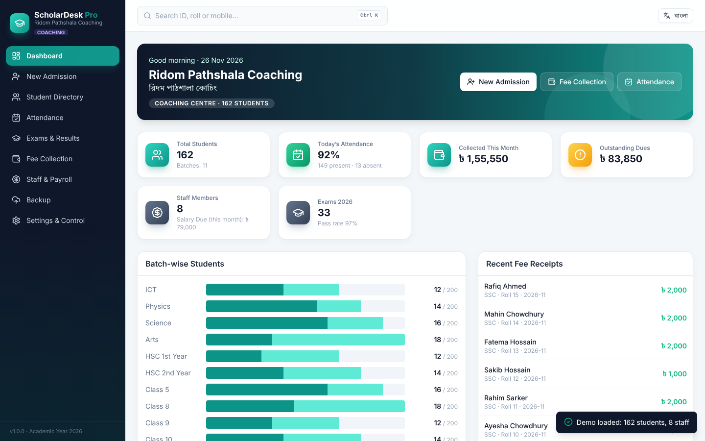

## 2. Installing and activating

1. Run `ScholarDesk Pro_1.0.0_x64-setup.exe` (from the **nsis** folder). Windows may say *Windows protected your PC* — click **More info → Run anyway**.
2. First screen:
   - **New school — request activation:** choose *School* or *Coaching centre*, fill in the name, contact person, mobile, district, address, approximate students and plan → **Send activation request**. The screen then shows **Waiting for Approval** and checks every minute.
   - **I have a license key:** type the key from your provider (e.g. `SCH-2026-7KQ4-M9XD`) → **Activate License**.
3. When approved, the app opens the **Welcome** screen: type the institution name (English/Bangla), then choose **Start fresh**, **Import demo data**, **Upload settings config** or **Restore a backup file**.

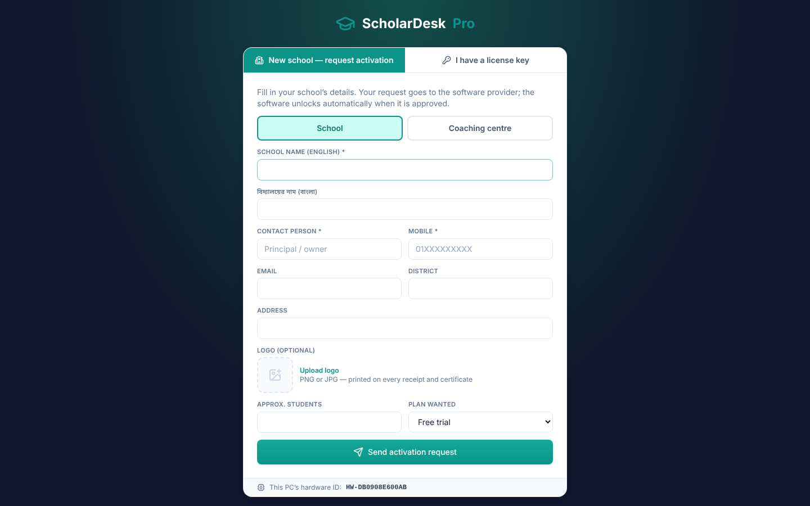

The license is bound to this PC. To move to a new PC, ask the provider to **Reset PC binding**, then restore your backup on the new PC.

## 3. Daily work

### New admission
*New Admission* → choose the **Class/Batch** and **roll** (the Student ID is generated as `YYCCRR`: year · class/batch · roll) → fill in the student and guardian details → **Photo**: *Browse image file* or *Live webcam capture* → **Review A4 Summary** → **Print / Save PDF & Submit** (or *Submit only*). The father's mobile is used for searching and SMS.

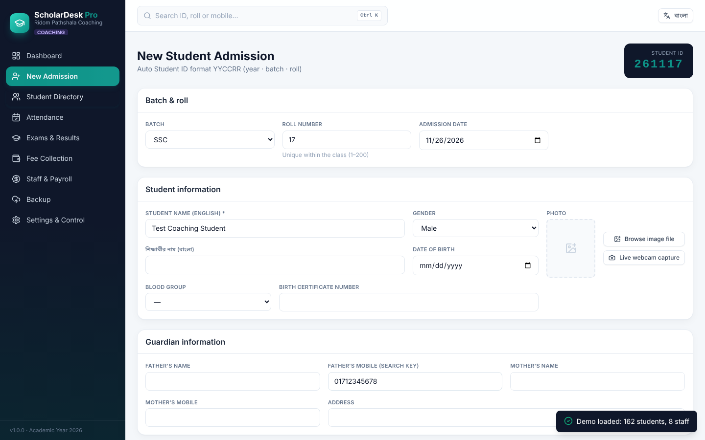

### Finding a student
Press **Ctrl + K** anywhere and type a Student ID, roll or guardian mobile. The profile shows personal details and fee history first, with buttons: **Pay Fee**, **Enter / Edit Marks**, **Attendance Report**, **Print Admission Form**, **Edit Student Info** (PIN 5555) and **View Result**.

### Student directory
Filter by class/batch and section, search, print the contact list or export CSV. Editing or deleting needs PIN **5555**.

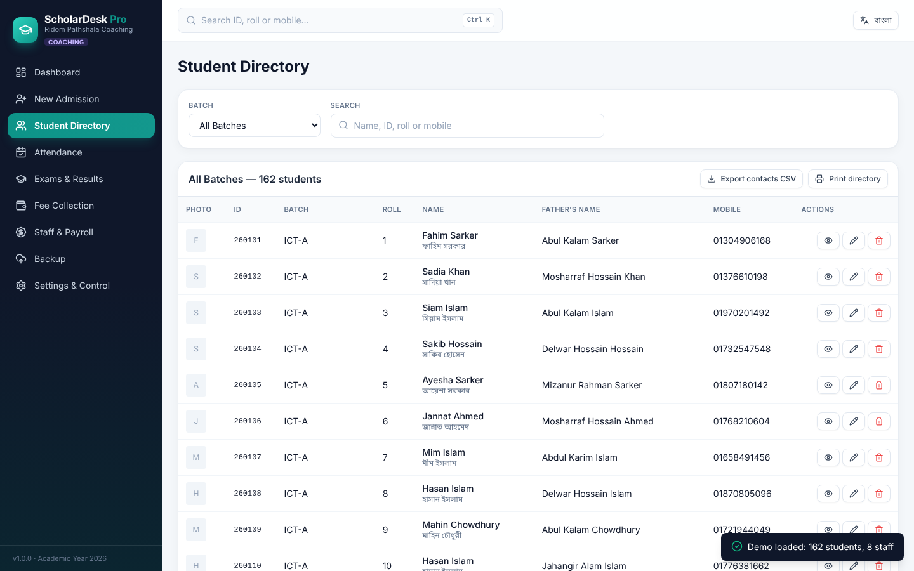

### Attendance
- **Mark Daily Attendance:** choose date and class/batch — everyone is *Present*; untick the absent ones → **Submit Attendance**.
- **Daily Summary:** totals, absent names, CSV and A4 for all or one class/batch.
- **Monthly Matrix:** green **P**, red **A**, grey **F** (Friday) grid; CSV and colour A4 print.

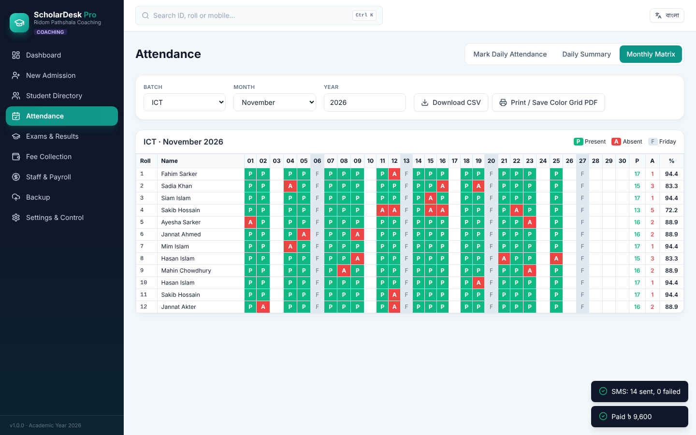

### Fees
Search the student → the oldest unpaid bill is selected → change the amount for a partial payment → **Save Payment & Print Receipt**. The receipt prints on two A4 pages: the receipt, and the student's attendance for that month.

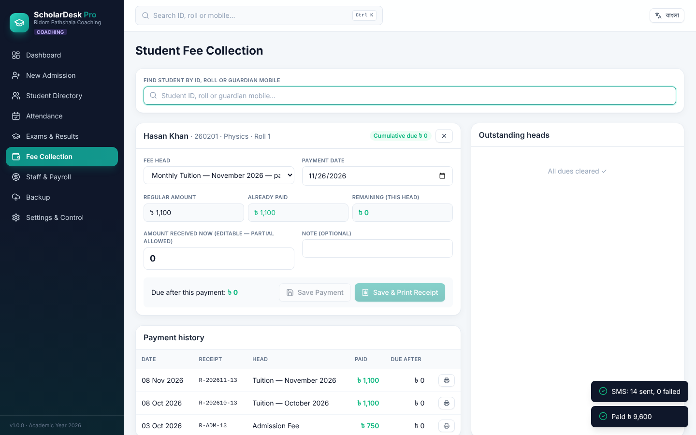

## 4. Exams and results

### Coaching centres
1. *Exams & Results* → click a **batch** → **New exam**: name (e.g. *Weekly Test 3*), date, full marks, pass marks and a **short note** (syllabus, type…).
2. Enter marks for the whole batch on one screen. Tick **Absent** for absent students and add a remark if you like. Percentage, grade and **merit position** appear immediately → **Save marks**. Changing saved marks needs PIN 5555.
3. **Print result sheet** (A4, sorted by position) and **Send result SMS**.

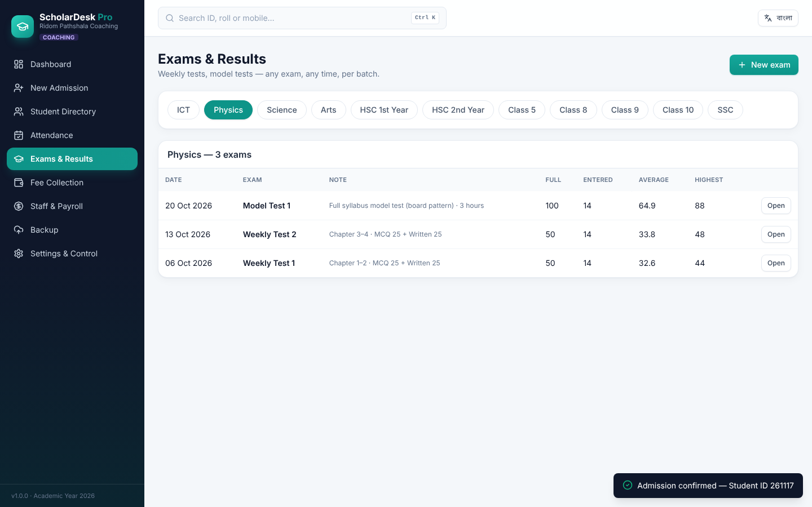
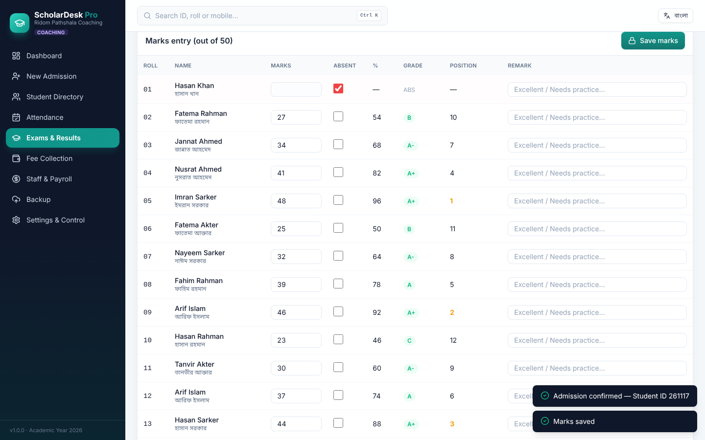
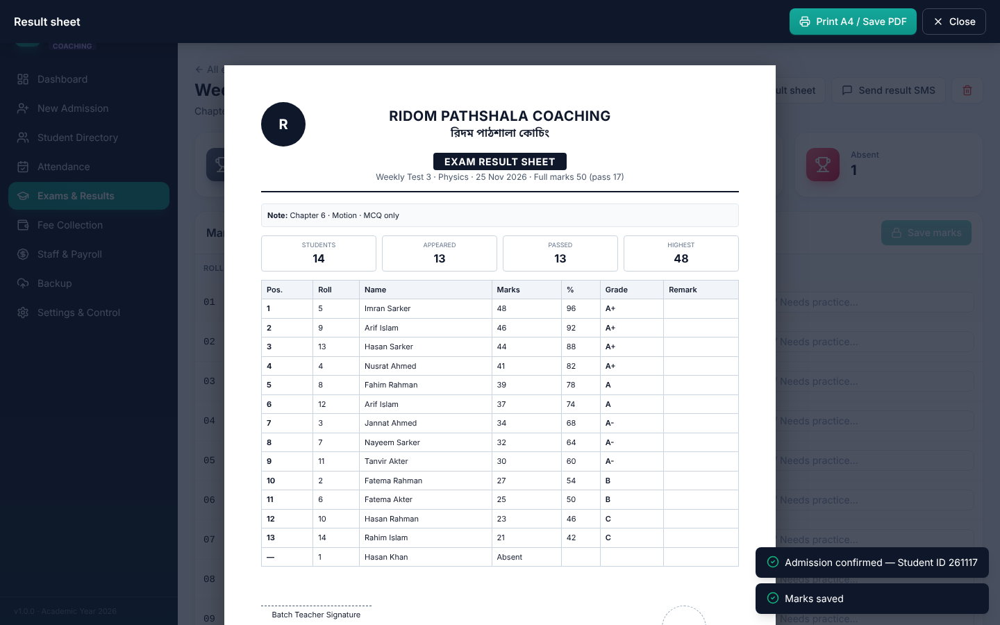

### Schools
Choose class, *Half Yearly* or *Final*, click a student, enter subject marks → GPA and grade are calculated → **Submit & Print Marksheet**. The **Send result SMS** button sends each guardian the total, percentage, position and GPA.

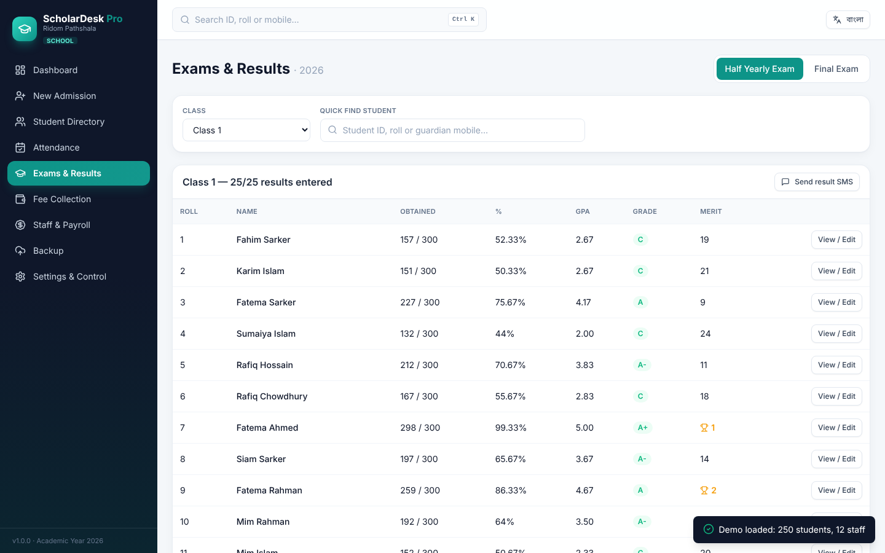

### Result SMS
The SMS window lists every student with the father's mobile and the exact message. Untick anyone you don't want, then **Send**. Absent students get an *“was ABSENT”* message instead. Sent SMS are marked so they are not sent twice by mistake. Edit the message in *Settings → SMS*.

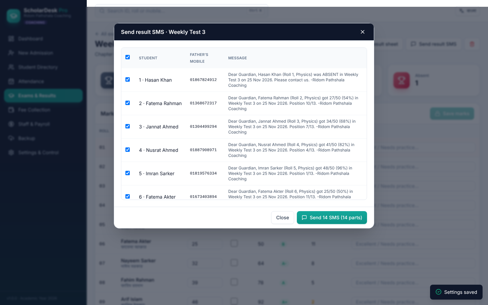

## 5. Teachers and staff pay
*Staff & Payroll* → **New Staff Registration** → choose how the teacher is paid:
- **Monthly salary** — pay full or part of the month's salary.
- **Daily rate** — enter the days worked; the total is days × rate.
- **Per class taken** — enter the number of classes; the total is classes × rate.

**Pay salary** prints an A4 payslip showing the calculation.

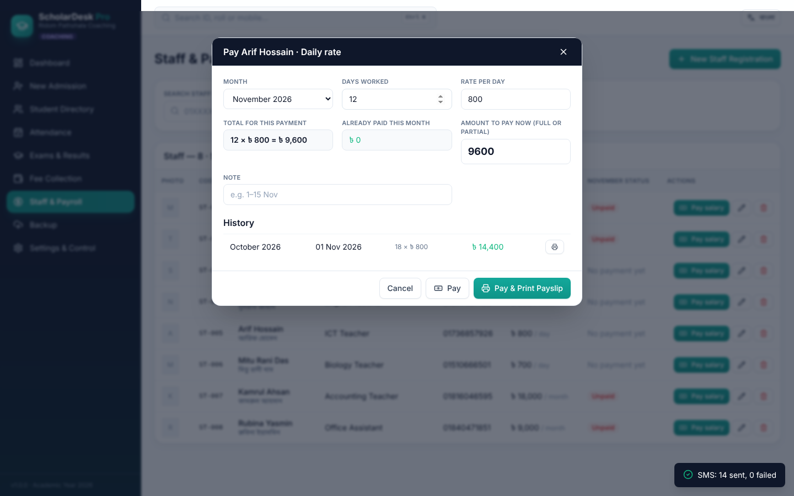

## 6. Settings & Control (PIN 0000)
- **Modules:** switch Exams, Payroll, Fees, Sections, Attendance on/off; automatic **screen lock** after 1–30 minutes (PIN 1234).
- **Batches** (coaching) / **Classes & Sections** (school): add batches, schedule, sections, monthly fee; untick *Shown* to hide an old batch.
- **Subjects & Marks** (school): subjects and full marks per class.
- **Centre/School & Fees:** name, logo, address, default fees, **photo folder** (every photo is also saved as a `.jpg` file).
- **SMS:** gateway and message template (see section 8).
- **PINs & License:** change PINs, verify the license, **Change license key** (e.g. switch to a `COA-` key).
- **Data, Config & Promotion:** settings config file, demo data, year-end promotion (school).

Every settings page has **Save changes / Discard** at the bottom.

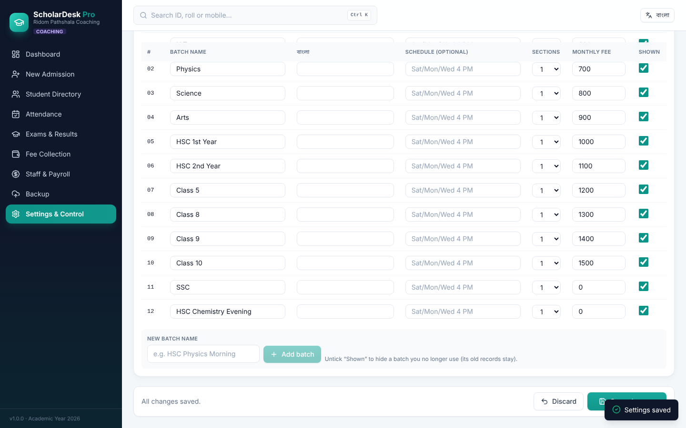

## 7. Backups
*Backup* page:
- **Local folder (recommended):** choose a folder on another drive or USB. The first start each day makes `ScholarDesk_<name>_YYYY-MM-DD.json` **before the app opens**; the newest 30 are kept; **Back up now** makes an extra one.
- **Telegram:** create a bot with **@BotFather** (`/newbot`), paste the token, send the bot any message, press **Find my chat**, **Send test backup now**. A backup arrives in Telegram every day.
- **Restore:** any backup file restores all data and settings (PIN 5555).

Each backup file contains **all data up to that day**, not only that day.

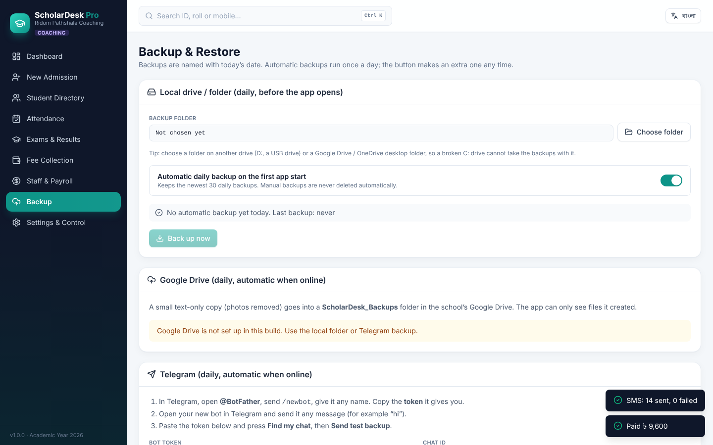

## 8. SMS gateway setup
*Settings → SMS*:
- **SMS company (API):** paste the provider's *send SMS* link, using `{to}` (01XXXXXXXXX) or `{to88}` (8801XXXXXXXXX) and `{msg}`. Example (BulkSMSBD):
  `https://bulksmsbd.net/api/smsapi?api_key=YOUR_KEY&type=text&number={to88}&senderid=YOUR_ID&message={msg}`
  Set *Success text* to what the provider returns on success (e.g. `202`). Press **Send test**.
- **My ESP32 + GSM:** flash `esp32-sms-gateway/esp32-sms-gateway.ino` (Wi-Fi name, password and a gateway key at the top), give the ESP32 a fixed IP in the router, then enter `http://<IP>` and the key in ScholarDesk. Power the SIM800L from a 2 A supply.

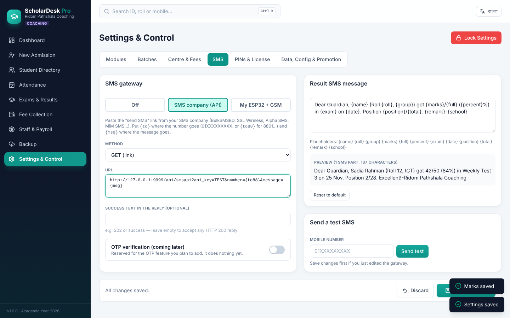

**OTP:** the switch is reserved for the OTP feature planned for a later version.

## 9. Licence, locks and emergency access
- The app checks the license every 15 minutes when online, and must go online at least once every 7 days.
- Locked because unpaid, turned off, offline too long or the clock was changed → the lock screen shows the payment instructions and **Verify Payment & Sync Online Now**.
- **Emergency access:** on the lock screen, enter the provider's **emergency PIN** (or a one-time code for the shown Lock ID). The software runs for **5 days**, **once per lock**; after payment and activation the next lock allows it again.
- **Use a different license key:** on the lock screen or in *Settings → PINs & License*.

## 10. Owner panel — https://school.rafid0.com (password-only login)
- **Dashboard:** active, suspended, expired, waiting, revenue, online in the last 7 days.
- **Pending requests:** new installations → **Approve** (plan, price, dates, max students) or **Reject**.
- **Schools & Licenses:** filter School / Coaching; **+ New School License**; **Turn OFF / Activate**.
- **School page:** record payment (extends the expiry and re-activates), license settings including **Product: School / Coaching**, reset PC binding, new key, emergency code for that PC, payment and heartbeat history.
- **Emergency code:** one-time 5-day code for any PC ID + Lock ID.
- **Settings:** payment instructions shown on locked screens, **emergency PIN for all schools**, **Download license backup** (do this monthly).

## 11. Troubleshooting
| Problem | Fix |
|---|---|
| “Cannot reach the license server” | Check internet; open https://school.rafid0.com in a browser; try again. The message shows the exact network error. |
| “License bound to another PC” | Provider: *Reset PC binding* on the school page. |
| “System clock problem” | Turn on automatic date & time in Windows, then verify online. |
| Webcam not working | Windows Settings → Privacy & security → Camera → allow desktop apps; close Zoom/Teams; press *Try again*. |
| SMS fails | *Settings → SMS → Send test*; check the API key/balance, the success text, or the ESP32 IP/key and SIM balance. |
| Daily backup failed | The backup drive/USB is missing — plug it in or choose the folder again. |

## 12. Keeping it running for 5+ years (owner checklist)
1. **Keys:** keep `license_private.pem` and the GitHub/Cloudflare secrets offline (USB + password manager). Losing the license key locks every school within 7 days.
2. **Monthly:** *Settings → Download license backup* in the panel; ask schools to keep daily backups on.
3. **Cloudflare free plan:** Worker + D1 database, no server to maintain. Renew **rafid0.com** every year.
4. **Updates:** a new installer is one GitHub action (*Actions → Windows installer → licensed*). Update dependencies once a year (`npm audit`, `cargo update`) and rebuild.
5. **Windows:** the app uses Microsoft WebView2, which Windows keeps updated automatically.
6. **Data format:** backups are plain JSON — readable by any future program.
